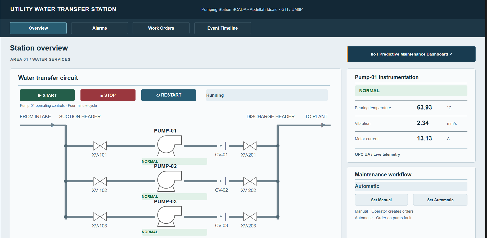
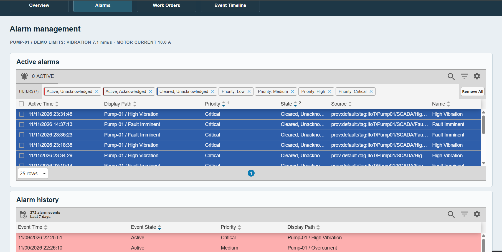
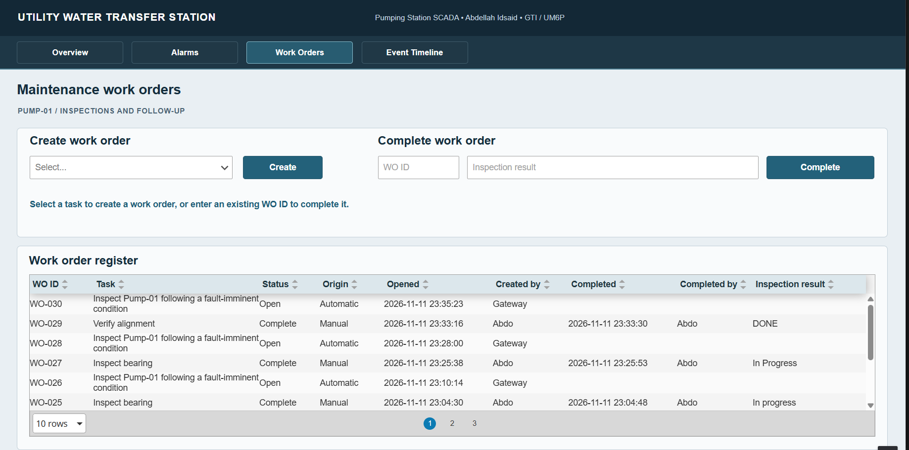
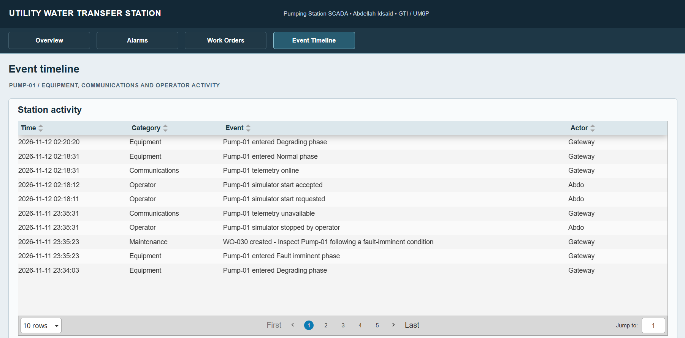

# IIoT Pump Station SCADA

An Ignition Perspective demo for a simulated utility water transfer station. It shows how operators monitor Pump-01, respond to alarms, and follow a developing fault through to a maintenance work order.

**[Watch or download the SCADA demo (MP4)](media/scada-system-demo.mp4)**

## Architecture

- **SCADA and control** · A Python pump simulator exposes bearing temperature, vibration, motor current, and operating mode over OPC UA. Ignition reads those tags for live monitoring and alarms. Operators can start, stop, or restart the simulator from Perspective.
- **Condition monitoring** · The simulator also publishes readings over MQTT to Mosquitto. Node-RED writes the data to InfluxDB for visualization in Grafana. The companion Python analytics service consumes MQTT telemetry for anomaly detection and fault diagnosis.
- **Maintenance workflow** · Ignition records station events and work orders in SQLite. Operators can create and complete work orders manually, or let the gateway open an inspection order when Pump-01 enters the fault-imminent phase.

## SCADA screens

### 1. Station overview

The water transfer circuit, Pump-01 controls, and live instrumentation.

### 2. Alarm management

Current alarm status and historical events, including high vibration, overcurrent, and fault-imminent alarms.

### 3. Maintenance work orders

Manual and automatic orders with inspection results and completion status.

### 4. Event timeline

A chronological log of equipment states, communications, operator actions, and maintenance activity.

